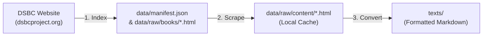

# Digital Sanskrit Buddhist Canon (DSBC) Scraper & Markdown Converter

A deterministic, high-performance toolkit to crawl, scrape, and convert the entire [Digital Sanskrit Buddhist Canon (DSBC)](https://www.dsbcproject.org) into formatted Markdown files.

Built with Python and designed to run with [`uv`](https://docs.astral.sh/uv/).

---

## 1. Project Review: https://www.dsbcproject.org

The **Digital Sanskrit Buddhist Canon (DSBC)** is an ambitious project initiated by the University of the West (Rosemead, CA) and the Nagarjuna Institute of Buddhist Studies (Kathmandu, Nepal) to digitize the extant Sanskrit Buddhist canon.

### Site Architecture & Taxonomy

- **Dual-Script Master Corpus:**
  - **Romanized (IAST):** 486 digitized texts available via `/canon-text/browse-by-list/1`.
  - **Devanāgarī:** 475 digitized texts available via `/canon-text/browse-by-list/77`.
  - **Total corpus:** 961 indexed books containing **2,893 distinct chapters/sections**. (58 entries are placeholders or bibliographic stubs without uploaded text).
- **Piṭaka Hierarchy:**
  - *Sūtrapiṭaka / सूत्रपिटक* (Avadāna, Dhāraṇī, Jātaka, Mahāyānasūtra, Prajñāpāramitā, etc.)
  - *Śāstrapiṭaka / शास्त्रपिटक* (Abhidharma, Madhyamaka, Yogācāra, Pramāṇa, Tantra commentaries, Stotras, etc.)
  - *Vinayapiṭaka / विनयपिटक*
- **Technical Quirks & Scraping Considerations:**
  1. **Header Filtering:** The server returns `406 Not Acceptable` if modern browser `Accept` and `User-Agent` headers are not provided.
  2. **Cloudflare Protection:** Rate limiting and DDoS protection are active; concurrency must be managed with keep-alive connection pooling and exponential backoff retry.
  3. **Inconsistent HTML Formatting:** Some texts wrap verse lines in `<p>` tags with empty `<p><br/></p>` paragraph separators (e.g. book 800), while others use raw text nodes interspersed with `<br/>` tags inside Foundation framework `div.news-section` containers (e.g. book 7). Word export artifacts (`o:p`, `MsoNormal`) and boilerplate strings (`end of title information`) are present.
  4. **Verse & Prose Structure:** Verses end with double dandas (`|| 1 ||` or `॥१॥`), while half-verses (pādas) end with single dandas (`|` or `।`) or commas.

---

## 2. Tool Architecture

The scraper is organized as a three-stage deterministic pipeline:



1. **Indexer (`dsbc index`):**
   - Fetches the master indices for Romanized and Devanagari texts.
   - Visits all 961 book pages to extract chapter links (`/canon-text/content/<book_id>/<content_id>`) and bibliographic metadata (Editor, Publisher, Year, etc.).
   - Outputs a deterministic manifest to `data/manifest.json`.
   - Caches book pages locally so indexing is 100% resumable and repeatable.

2. **Scraper (`dsbc scrape`):**
   - Reads `data/manifest.json` and downloads every chapter HTML page.
   - Caches raw HTML in `data/raw/content/<book_id>_<content_id>.html`.
   - Resumable: skips already downloaded files. If interrupted, simply re-run.
   - Built on `httpx` async I/O with concurrency controls and exponential backoff.

3. **Converter (`dsbc convert`):**
   - Parses the cached HTML files offline without network dependencies.
   - Normalizes Sanskrit verse stanzas:
     - Half-verses (`|` / `।`) receive two trailing spaces (`  \n`) for Markdown hard breaks.
     - Stanza endings (`||` / `॥`) receive a double newline (`\n\n`).
     - Prose text is flowed into readable Markdown paragraphs.
   - Injects YAML frontmatter with book ID, URLs, categorization, and technical metadata (input date, proofreader, parallel edition, etc.).
   - Emits structured files to `texts/<script>/<pitaka>/<category>/<book>.md`.
   - Generates/updates `texts/CATALOG.md` with links to all converted texts.

---

## 3. Quick Start (via `uv`)

Prerequisites: [`uv`](https://docs.astral.sh/uv/) installed on macOS/Linux.

### Install dependencies
```bash
uv sync
```

### Check repository status
```bash
uv run dsbc info
```

### Run the full pipeline (Index -> Scrape -> Convert)
To index, download, and convert all 961 texts:
```bash
uv run dsbc all
```

---

## 4. CLI Usage & Commands

### 1. Index the Canon Catalog
Builds or updates `data/manifest.json`:
```bash
# Index all 961 books across Romanized and Devanagari (concurrency 10 takes ~30 seconds)
uv run dsbc index --concurrency 10

# Index only Romanized books
uv run dsbc index --script romanized

# Index only Devanagari books
uv run dsbc index --script devanagari

# Test index on first 10 books
uv run dsbc index --limit 10
```

### 2. Scrape Raw Content Pages
Downloads content pages into `data/raw/content/` (fully resumable):
```bash
# Scrape all content pages across the entire canon
uv run dsbc scrape --concurrency 8

# Scrape only Romanized or Devanagari texts
uv run dsbc scrape --script romanized
uv run dsbc scrape --script devanagari

# Scrape a specific book by ID
uv run dsbc scrape --book-id 7
uv run dsbc scrape --book-id 367

# Test scrape on the first 20 pages
uv run dsbc scrape --limit 20
```

### 3. Convert Cached Pages to Markdown
Parses cached HTML and writes clean Markdown to `texts/`:
```bash
# Convert all downloaded texts
uv run dsbc convert

# Convert only Romanized or Devanagari
uv run dsbc convert --script romanized
uv run dsbc convert --script devanagari

# Convert a specific book
uv run dsbc convert --book-id 7

# Also output individual chapter files into subfolders
uv run dsbc convert --split-chapters
```

---

### 4. Transliterate Devanāgarī books that have no romanised version

Most Devanāgarī books in DSBC also exist in a romanised (IAST) edition, which was keyed in separately. Ten do not, and
for those `dsbc transliterate` writes an IAST version with [Aksharamukha](https://www.aksharamukha.com/python), listed
in [`data/transliterate.json`](data/transliterate.json):

```bash
uv run dsbc transliterate              # the books listed in data/transliterate.json
uv run dsbc transliterate --book-id 364
```

The files go to `texts/romanized/<category>/`, listed in [`texts/TRANSLITERATED.md`](texts/TRANSLITERATED.md). They are
**machine transliterations**, and the Devanāgarī book remains the authoritative text. The front matter says so
(`transliterated_from`, `transliteration`), and gives the book id as `<id>-iast`. Only Devanāgarī characters are
transliterated, so the structure of the file is unchanged. Conventions: dandas `।` `॥` are written `|` `||` (not
Aksharamukha's `.` `..`), and a nukta is dropped, because in Sanskrit texts it is a typing artefact (`स्फ़ुट` is
*sphuṭa*, not "sfuṭa"). To check that Aksharamukha follows the IAST of DSBC's own romanised editions, I compared it
with the 338 books that exist in both scripts: the median agreement is 0.999 word for word, ignoring spelling of
nasals and punctuation.

The project pins Python 3.12, because Aksharamukha 2.3 does not run on Python 3.14 or later.

## 5. Output Format & Directory Layout

### Directory Hierarchy

```
texts/
├── CATALOG.md                                 # Full catalog index with links
├── romanized/
│   ├── sūtrapiṭaka/
│   │   ├── avadāna/
│   │   │   └── Svayambhū purāṇa.md
│   │   └── ...
│   ├── śāstrapiṭaka/
│   │   ├── yoginītantraṭīkā/
│   │   │   └── Tattvajñānasaṁsiddhiṭīkā.md
│   │   └── ...
│   └── vinayapiṭaka/
└── devanagari/
    ├── सूत्रपिटक/
    │   └── अवदान/
    │       └── स्वयम्भूपुराण.md
    └── ...
```

### Markdown File Structure

Each converted Markdown file starts with YAML frontmatter:

```markdown
---
title: Tattvajñānasaṁsiddhiṭīkā
script: romanized
category: śāstrapiṭaka/yoginītantraṭīkā
category_path: Romanized»śāstrapiṭaka»yoginītantraṭīkā
book_id: 800
source_url: https://www.dsbcproject.org/canon-text/book/800
chapters_count: 1
bibliography:
  Title: Tattvajñānasaṁsiddhiṭīkā
  Editor: Jnanacandra
  Publisher: '-'
  Place of Publication: '-'
  Year: '-'
technical_details:
  Text Version: Romanized
  Input Personnel: Milan Shakya
  Input Date: '2018'
  Proof Reader: Miroj Shakya
  Supplier: Nagarjuna Institute of Buddhist Studies
  Sponsor: University of the West
---

# Tattvajñānasaṁsiddhiṭīkā

praoṃ namaḥ śrībhagavatyai vajravārāhyai ||

ānandāmbudhimaṇḍanādupagatā sambuddhalakṣmīrasau |  
sarvākāraguṇānvitā jagadadhadhvā ntaughavidhvaṃsinī ||

jyotirjñānanidhedhṛtiḥ smṛtinidheḥ śāntirmanīṣānidheḥ |  
pāyādvajravirāsinī bhagavatī lokatrayaṃ durgateḥ || 1 ||
```
